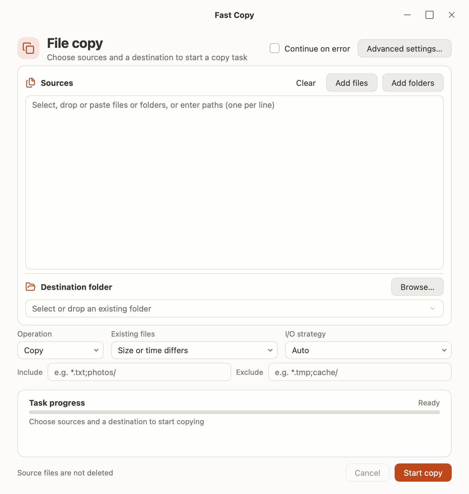
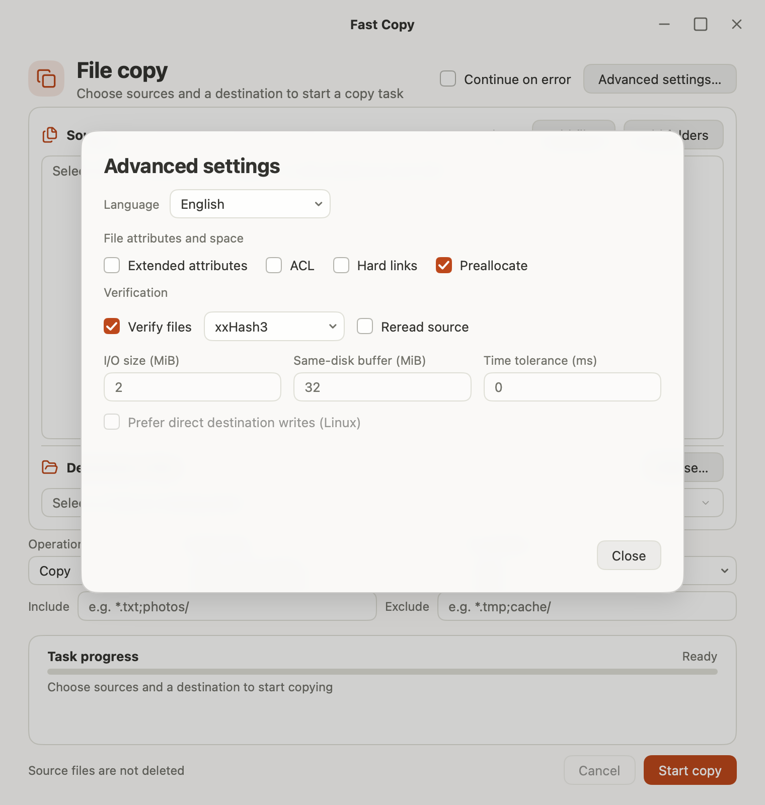

# Fast Copy

English | [简体中文](README.md)

Fast Copy is a graphical file copy tool for Linux and macOS, built with [mygo](https://github.com/egoist/mygo) and [onevra](https://github.com/oneo-me/onevra). The interface supports Simplified Chinese and English.



## Features

- Add multiple sources, drag and drop or paste paths, and reuse recent destinations.
- Choose how to handle existing files, filter paths, pause or cancel tasks, and verify files without copying.
- Use batched reads and writes for the same disk or parallel I/O for different devices, with optional verification and preservation of file attributes and hard links.
- Switch between Chinese and English, choose a light, dark, or system theme, and configure verification algorithms, buffers, and I/O settings in the advanced settings dialog. Settings are saved automatically.



## Install

Download the package for your system and architecture from [GitHub Releases](https://github.com/ruanimal/fast-copy-go/releases/latest):

- **macOS**: Open the DMG for Apple Silicon (arm64) or Intel (amd64) and drag Fast Copy to Applications. The package uses an ad hoc signature and is not notarized by Apple, so Gatekeeper may prevent it from opening.
- **Linux**: Choose a `.deb`, `.rpm`, or `.tar.gz` for your architecture. On Debian / Ubuntu, for example, run `sudo apt install ./package-name.deb`; the archive's `install.sh` installs to the current user's `~/.local`. GTK 3 and a graphical desktop are required.

The release also includes `SHA256SUMS` for checking downloaded files.

## Quick start

1. Use the buttons beside “Sources” to add files or folders, then use “Browse” beside “Destination folder” to select an existing folder.
2. Choose how to handle existing files, an I/O strategy, and filters as needed.
3. Click “Start copy”. You can pause, resume, or cancel a task; completed files are not rolled back.

By default, files are copied when their size or modification time differs and verified with xxHash3. Regular files replace their destination only after writing, syncing, and optional verification complete. Features such as synchronization, moving, and deletion are not yet implemented.

You can also pass one or more sources and an existing destination directory on the command line. By default the GUI opens with the paths filled in, and copying begins only when you click “Start copy”. Use `--cli` to copy directly:

```sh
fast-copy "source directory" "destination directory"
fast-copy --cli "source directory" "another source" "destination directory"
```

Direct command-line copying uses the defaults, independently of saved GUI settings. Run `fast-copy --help` for usage.

See the [detailed guide (Chinese)](docs/guide.zh-CN.md) for usage, platform differences, building, packaging, and testing.
