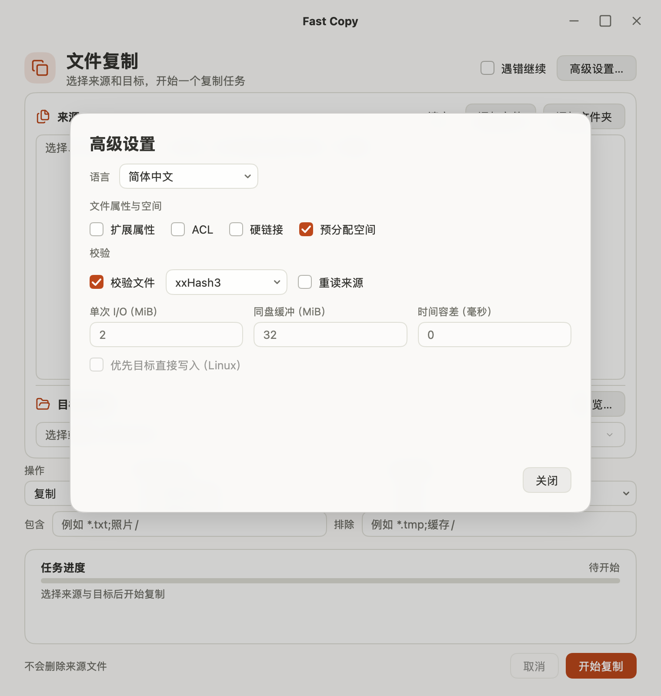

# Fast Copy

[English](README.en.md) | 简体中文

Fast Copy 是一款适用于 Linux 和 macOS 的图形化文件复制工具，使用 [mygo](https://github.com/egoist/mygo) 和 [onevra](https://github.com/oneo-me/onevra) 构建，支持简体中文和英文界面。

## 功能

- 支持多个来源、拖放或粘贴路径，以及最近使用的目标文件夹。
- 提供覆盖策略、包含／排除过滤、暂停和取消，以及只读校验。
- 根据存储设备选择同盘批量读写或并行读写，可选复制后校验、保留文件属性和硬链接。
- 在高级设置中切换中英文，调整校验算法、缓冲区和 I/O 参数；设置会自动保存。

## 安装

从 [GitHub Releases](https://github.com/ruanimal/fast-copy-go/releases/latest) 下载适合系统和架构的安装包：

- **macOS**：打开对应 Apple Silicon（arm64）或 Intel（amd64）的 DMG，将 Fast Copy 拖入“应用程序”。安装包使用临时签名，未经过 Apple 公证，Gatekeeper 可能阻止打开。
- **Linux**：选择对应架构的 `.deb`、`.rpm` 或 `.tar.gz`。例如，Debian / Ubuntu 可运行 `sudo apt install ./包名.deb`；压缩包中的 `install.sh` 安装到当前用户的 `~/.local`。需要 GTK 3 和图形桌面。

Release 同时提供 `SHA256SUMS` 以校验下载文件。

## 快速使用

1. 使用“来源”右侧的按钮添加文件或文件夹，再通过“目标文件夹”右侧的“浏览”选择已有文件夹。
2. 按需设置已有文件处理方式、读写策略和过滤规则。
3. 点击“开始复制”；任务可暂停、继续或取消，已完成的文件不会回滚。

默认按大小或修改时间判断是否复制，并使用 xxHash3 校验。普通文件在写入、同步和可选校验完成后才替换目标。项目尚未实现同步、移动或删除等所有 FastCopy 功能。

详细使用说明、平台差异、构建、打包和测试方法见 [详细文档](docs/guide.zh-CN.md)。
